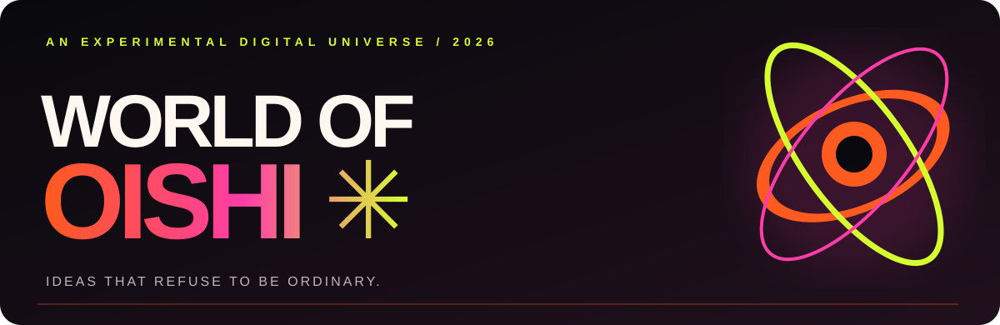
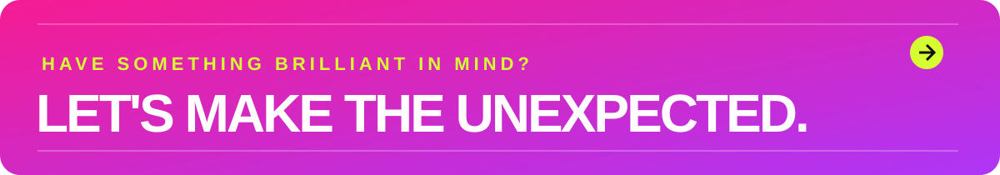

<div align="center">



<br />

[](https://github.com/oishipaul45-engineer/WorldOfOishi)
[](https://react.dev/)
[](https://threejs.org/)

**A portfolio that moves, glows, and tells stories.**  
*Not a collection of cards. A world you scroll through.*

</div>

---

## ✳ Enter the world

I'm **Oishi Paul**, an aspiring AI engineer and full-stack developer drawn to the space where **engineering meets imagination**.

**World of Oishi** is my experimental personal website: six projects, six distinct 3D sculptures, and one continuous story. Each chapter has its own identity, while the interface stays unapologetically creative.

> **I build things that refuse to be ordinary.**

## ◇ Six projects · six perspectives

<table>
<tr><td width="50%" valign="top">

### ✧ AETHERA
An immersive personal universe for ideas, thoughts, and connections.

[Explore project](https://aethera-nine.vercel.app/) · [Source](https://github.com/oishipaul45-engineer/AETHERA)

</td><td width="50%" valign="top">

### ⌘ CAMPVERSE
A digital space exploring campus life and student experiences.

[Explore project](https://campverse-d5016.web.app/)

</td></tr>
<tr><td width="50%" valign="top">

### ♫ SONORA
Where music, interaction, and creative technology intersect.

[Explore project](https://sonora-two-psi.vercel.app/)

</td><td width="50%" valign="top">

### ✳ SKILLORBIT
A platform focused on skills, learning, and collaboration.

[Explore project](https://oishipaul45-engineer.github.io/SkillOrbit/)

</td></tr>
<tr><td width="50%" valign="top">

### ◈ CREDORA
A workspace for personal identity, growth, and professional direction.

[Explore project](https://credora-connect.vercel.app/)

</td><td width="50%" valign="top">

### ↗ FINOVA
Financial information translated into clear, interactive insights.

[Explore project](https://finova-a6602.web.app/)

</td></tr>
</table>

## ⚡ Built for exploration

<table>
<tr><td>🪩 <b>Living 3D art</b></td><td>Project-specific sculptures rendered with React Three Fiber.</td></tr>
<tr><td>🌀 <b>Scroll chapters</b></td><td>A story that unfolds as you move through the site.</td></tr>
<tr><td>✳ <b>Morphing cursor</b></td><td>A glowing symbol that changes across project chapters.</td></tr>
<tr><td>🎨 <b>Unexpected palette</b></td><td>Obsidian, fluorescent orange, electric pink, and acid lime.</td></tr>
<tr><td>✉️ <b>Personal connection</b></td><td>Résumé, GitHub, LinkedIn, and a playful contact finale.</td></tr>
</table>

## 🧰 Tools behind the world

<div align="center">


</div>

## 🛠 Run locally

```bash
# 1. Clone
 git clone https://github.com/oishipaul45-engineer/WorldOfOishi.git

# 2. Enter the project
 cd WorldOfOishi

# 3. Install
 npm install

# 4. Explore
 npm run dev
```

Open the local address printed by Vite. To create a production build, run `npm run build`.

## 🪐 The idea behind it

The internet doesn't have to look the same everywhere. **This portfolio is a place to experiment**—with light, motion, interactive objects, and the feeling of discovering something new.

It's a living project, not a finished template.

<div align="center">



[](mailto:oishipaul45@gmail.com)
[](https://github.com/oishipaul45-engineer)
[](https://www.linkedin.com/in/oishi-paul-328a37399)

<sub>Designed with curiosity · Built by Oishi Paul · © 2026</sub>

</div>
